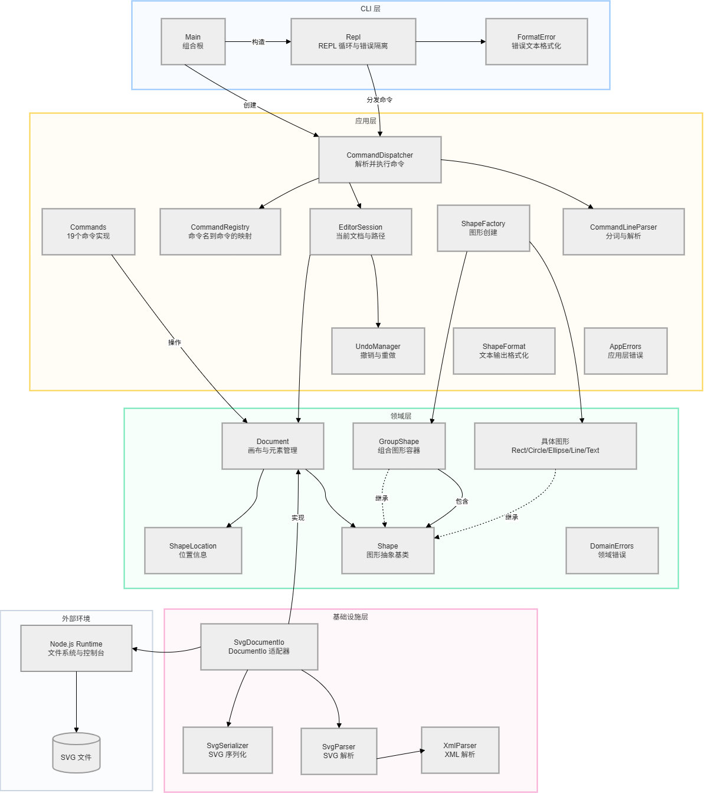

# handleSVG 项目说明

## 1. 项目状态

本项目是一个 TypeScript + Node.js 实现的 SVG CLI 编辑器，已完成 Lab1 Phase 1 的核心功能：

- 六种内置图形：`rect`、`circle`、`ellipse`、`line`、`text`、`g`。
- 基于唯一 id 的图形定位。
- Composite 容器和递归操作。
- Command 模式编辑、undo/redo。
- 完整编辑、显示和画布命令。
- SVG 文件读取、序列化、缺 id 补全和 round-trip。
- REPL 和错误隔离。
- 外部 SVG 测试夹具与自动化测试。

代码已通过 Git 分阶段提交并推送至远程仓库；最终提交版本须在截止时间前创建统一命名为 `final` 的 tag。

## 2. 快速开始

环境要求：Node.js 22.18 或更高版本。

```powershell
cd C:\study\year1\handleSVG\handleSVG
npm run cli
```

示例：

```text
svg> init 800 600
svg> create g node1
svg> create rect box 120 100 160 60 #4a90d9 in node1
svg> create text label 155 135 "开始" in node1
svg> tree
svg> save "demo.svg"
svg> read "demo.svg"
svg> exit
```

完整操作说明见根目录 [TUTORIAL.md](../TUTORIAL.md)。

## 3. 架构方案

### 3.1 模块划分与目录结构

项目按职责划分为 `domain`、`application`、`infrastructure`、`cli` 四个核心模块，并以 `test`、`scripts` 作为支撑目录。目录结构如下：

```text
src/
├── domain/
│   ├── Document.ts
│   ├── ShapeLocation.ts
│   ├── errors/
│   └── shapes/
├── application/
│   ├── Command.ts
│   ├── CommandContext.ts
│   ├── EditorSession.ts
│   ├── UndoManager.ts
│   ├── commands/
│   ├── dispatch/
│   ├── errors/
│   ├── factory/
│   ├── format/
│   ├── parsing/
│   └── ports/
├── infrastructure/
│   └── svg/
└── cli/
    ├── Repl.ts
    ├── formatError.ts
    └── main.ts
test/
├── fixtures/
└── *.test.ts
scripts/
└── check-syntax.mjs
```

模块职责及依赖方向如包图所示：



*图 1：handleSVG 包图，用于展示核心模块之间的依赖关系。*

### 3.2 模块职责

| 模块 | 职责 |
|---|---|
| `domain/` | 图形类层次、Document、唯一 id 索引、父子关系、z-order、几何操作和领域错误。 |
| `domain/shapes/` | Shape 抽象基类及 Rect、Circle、Ellipse、Line、Text、Group 复合图形。 |
| `application/` | EditorSession、Command 契约、UndoManager、IO 端口和命令上下文。 |
| `application/commands/` | 每个 CLI 编辑、显示、文档或 IO 命令对应的 Command 对象。 |
| `application/dispatch/` | 命令注册表、命令名到 Command 的分发和默认命令装配。 |
| `application/factory/` | ShapeFactory，统一负责内置图形类型到具体类的创建。 |
| `application/parsing/` | REPL 行解析、双引号参数、转义和注释处理。 |
| `application/format/` | tree、show、移动和属性变更结果的文本格式。 |
| `application/ports/` | DocumentIo 端口和未配置 IO 的默认实现。 |
| `infrastructure/svg/` | XML 解析、SVG 语义解析、SVG 序列化和文件系统适配器。 |
| `cli/` | REPL、提示符、错误输出和进程入口。`main.ts` 是当前组合根。 |
| `scripts/` | 可复现的 TypeScript 语法检查脚本。 |
| `test/` | 领域、命令、历史、REPL、显示、SVG 读写和 round-trip 测试。 |

### 3.3 依赖方向

| 来源 | 允许依赖 | 说明 |
|---|---|---|
| `domain` | 仅自身模块和 TypeScript 标准能力 | 不依赖 CLI、应用层、XML 或文件系统。 |
| `application` | `domain`、应用层自身模块 | 通过端口使用 IO，不导入基础设施实现。 |
| `infrastructure` | `application` 端口/工厂契约、`domain`、Node 标准库 | 实现 SVG 和文件系统适配。 |
| `cli/Repl.ts` | `application`、CLI 自身工具、Node 标准库 | 只调用命令分发器；输入输出使用 Node 标准流。 |
| `cli/main.ts` | `application`、`infrastructure` | 唯一组合根，负责注入 `SvgDocumentIo`。 |
| `scripts` | Node 标准库 | 独立质量检查脚本。 |
| `test` | 被测模块 | 从公开契约验证行为。 |

已执行依赖扫描：

- `domain` 中不存在对 `application`、`infrastructure` 或 `cli` 的导入。
- `application` 中不存在对 `infrastructure` 或 `cli` 的导入。
- 没有发现循环依赖。
- 类创建的类型分派只存在于 `ShapeFactory`；命令名分派由 `CommandRegistry` 的映射完成。
- `SvgParser` 不直接创建具体图形类，而是委托 `ShapeFactory.createFromAttributes`。

### 3.4 设计模式的选择与落地

项目使用了题目要求的 **Command 模式**，并围绕职责边界采用了 Composite、Factory、Adapter、Registry 和 Template Method。

| 模式 | 落地位置 | 用途 |
|---|---|---|
| Command | `application/commands/`、`Command.ts`、`UndoManager` | 一条命令封装一次操作、执行参数及其撤销逻辑。 |
| Composite | `Shape`、`GroupShape` | 容器和叶子图形使用统一操作契约，容器递归处理子节点。 |
| Factory | `ShapeFactory` | CLI create 和 SVG 读取共用同一图形创建入口。 |
| Adapter | `DocumentIo`、`SvgDocumentIo` | 应用层不直接依赖文件系统和 XML 解析器。 |
| Registry | `CommandRegistry` | 集中注册命令，避免散落的命令名分支。 |
| Template Method | `Shape` 基类 | 统一 move/scale/set 流程，子类实现几何细节。 |

Command 模式的落地方式如下：

- `Command` 接口定义 `execute()`，需要支持撤销的命令同时实现 `undo()`；`historyPolicy` 区分记录、重置和锁定历史等行为。
- 每个编辑操作由独立命令对象表示，例如 `CreateCommand`、`MoveCommand`、`GroupCommand` 等。命令在构造阶段解析并校验参数，在 `execute()` 时修改文档。
- `UndoManager` 只负责维护 undo/redo 栈和 IO 边界，不直接操作图形；执行成功后保存命令对象，撤销时调用该对象的 `undo()`，重做时再次调用 `execute()`。
- `CommandRegistry` 负责把命令名映射到命令工厂，`CommandDispatcher` 负责解析输入并交给 `EditorSession`，避免在 REPL 中堆叠命令分支。

### 3.5 变化点假设

判断未来最可能发生变化的是以下几处。每项都说明已预留的扩展点，或当前决定不预留的理由。

| 变化点 | 预留内容或不留理由 |
|---|---|
| 新增图形类型或图形插件 | 已预留统一创建入口 `ShapeFactory`，新增内置图形时集中扩展该处。当前不引入动态插件加载和 `ShapeProvider`，因为题目只要求六种内置图形，提前增加插件协议会提高理解与测试成本。 |
| SVG 语法或文件格式扩展 | 已通过 `DocumentIo` 端口隔离持久化，解析器、序列化器和文件系统适配器可在 `infrastructure/svg/` 内独立演进，不污染领域层。 |
| 新增编辑或查询命令 | 已预留 `Command` 契约和 `CommandRegistry`。新增命令可独立实现并注册，不需要修改 REPL 的分派逻辑。 |
| 从 CLI 扩展到 GUI 或 Agent 入口 | 已通过 `EditorSession`、`CommandDispatcher` 和 `Command` 将交互入口与业务操作分离。当前不为尚不存在的 GUI 建立独立表现层。 |
| undo/redo 策略变化 | 已保留 `Command.undo()` 契约，必要时可替换为快照或操作日志方案。当前文档规模较小，使用命令级撤销足以满足需求，暂不引入快照带来的内存开销。 |
| 输出格式或展示终端变化 | 当前格式化集中在 `application/format/`，单 CLI 场景下可直接复用。暂不拆独立 presentation 层，因为只有一种输出通道；若增加 GUI，再拆分展示模型。 |
| 持久化目标变化 | 已通过 `DocumentIo` 端口与 `SvgDocumentIo` 适配器隔离；若未来增加其他格式或远程存储，可新增适配器而不是修改应用层。 |

## 4. 过程记录

本节记录开发中具有代表性的讨论、问题发现和纠正过程。项目采用分阶段推进，并用自动化测试和人工审查校验 AI 生成的设计与代码。

### 4.1 从架构约束推导实现

阶段一先确定领域层、应用层、基础设施层和 CLI 的依赖方向，再开始写代码。实现过程中没有把文件系统或 REPL 逻辑放进领域模型。

AI 生成的首版设计强调只允许两处类型分派：命令分发和图形工厂。该约束在最终扫描中用于发现并修正 SVG 解析器中的重复类型分派。

### 4.2 测试发现 group/ungroup 结构问题

阶段二测试发现：

- `group` 最初按第一个参数的位置插入新组，实际应插入到所有选中节点中最早的位置。
- `ungroup` 后旧容器 id 仍残留在文档索引中。

两项问题均通过回归测试暴露，随后修正 Document 的插入位置计算和索引清理逻辑。现有测试覆盖 undo 后恢复原始同级顺序。

### 4.3 失败原子性修正

阶段二测试还发现，非法新组 id 可能在选中节点已经从文档摘除后才抛错。修正方式是在任何结构变更前先构造并校验新 GroupShape，保证失败命令不改变文档。

### 4.4 REPL 非交互输入问题

REPL 集成测试使用内存输入流时出现 `ERR_USE_AFTER_CLOSE`。原因是在 readline 已随输入结束关闭后仍调用 prompt。修正为仅在 `readline.closed` 为 false 时输出 prompt，真实终端交互不受影响。

### 4.5 SVG 解析器的类型分派重构

阶段六依赖扫描发现 `SvgParser` 使用 `switch (element.name)` 直接创建具体图形类，形成第二套类型分派，违反架构约束。

修正方式：

- ShapeFactory 增加 `createFromAttributes`，统一处理 SVG 属性到图形参数。
- SvgParser 只把元素名、属性映射和文本内容传给 ShapeFactory。
- 最终具体类创建分派只保留在 ShapeFactory。

### 4.6 SVG IO 的失败隔离

`read` 先由适配器解析成完整的新 Document，成功后才替换 EditorSession 中的当前文档；因此文件不存在、XML 错误或结构错误不会破坏已有文档。

`save` 只有在文件成功写入后才更新当前路径并触发历史锁定；写入失败不会改变文档或历史状态。

### 4.7 浏览器渲染验证

Edge headless 在当前环境因 GPU/Profile 权限失败。Chrome headless 使用独立用户目录成功生成 400×200 截图。

进一步通过像素检查确认：

- 截图尺寸为 400×200。
- 非白色像素为 14600。
- 预期蓝色区域为 7200 像素。
- 预期橙色区域为 7200 像素。

该结果证明生成的 SVG 不只是 XML 可解析，也能被真实浏览器渲染。

### 4.8 AI 建议的取舍

- 保留：Command、Composite、Factory、Adapter 和命令注册表。
- 保留：先写测试再修正结构问题。
- 暂缓：`box` 插件、动态插件加载和结构路径寻址。
- 暂不引入：外部 XML 依赖；当前环境网络受限，使用受控的内置 XML 解析器。
- 补充：包图已提供于 `doc/包图.drawio.png`，用于直观展示模块及其依赖关系。

## 5. 一致性自查

### 5.1 模块划分一致性

| 方案 | 实际 | 结论 |
|---|---|---|
| `domain` 独立领域模型 | `src/domain/` | 一致 |
| `application` 命令、历史、解析和格式化 | `src/application/` | 一致 |
| `infrastructure` SVG IO | `src/infrastructure/svg/` | 一致 |
| CLI 表现层 | `src/cli/` | 一致 |
| 组合根独立目录 | 无 `src/bootstrap/`，由 `src/cli/main.ts` 装配 | 有偏差，已记入 5.2 |
| 独立 presentation 格式化层 | 格式化位于 `src/application/format/` | 有偏差，已记入 5.2 |
| 插件目录 | 当前未实现 `src/plugins/` | 阶段边界内未实现，已记入 5.2 |

明确回答：实际目录与方案的核心分层一致。实际存在组合根位置、格式化层位置和插件目录三项偏差，均已记录在修订记录中，不影响当前依赖方向。

### 5.2 修订记录（方案与实际）

| 编号 | 原方案 | 实际实现或修订 | 原因与影响 |
|---|---|---|---|
| R1 | 独立 `src/bootstrap/` 组合根 | 由 `src/cli/main.ts` 承担组合根 | 当前只有 CLI 一个入口，独立目录没有额外收益；应用层与基础设施层仍只在该组合根汇合。 |
| R2 | 独立 presentation 格式化层 | 暂用 `src/application/format/` | 当前只有 CLI 且格式化输入来自命令结果；避免为单一展示通道增加层数。未来增加 GUI 时再拆分。 |
| R3 | 后续阶段提供 `src/plugins/` 与 `box` 插件 | 本阶段未实现 | `box` 和 ShapeProvider 属于后续插件化范围，当前需求只要求六种内置图形。 |
| R4 | 初版文档仅用目录、职责表和依赖表说明架构 | 新增 `doc/包图.drawio.png` | 本次作业明确要求模块划分附图，补充包图以提高架构可读性。 |

### 5.3 依赖方向自查

- 领域层没有导入应用层、基础设施层或 CLI。
- 应用层没有导入基础设施层或 CLI。
- 基础设施层只导入应用层端口/工厂契约、领域模型和 Node 标准库。
- CLI 的 `Repl` 只依赖应用层；`main.ts` 是唯一同时导入应用层和基础设施层的位置。
- 抽样检查 `CreateCommand`、`SvgParser`、`SvgDocumentIo` 和 `main.ts` 的 import 后，未发现违反依赖方向的情况。
- 未发现循环依赖。

### 5.4 范式与分派自查

- 使用 TypeScript 面向对象类层次。
- 图形类字段私有化，通过方法访问和修改。
- 类按文件拆分。
- 主业务逻辑没有贫血模型或过程式自由函数。
- 命令名分派在 `CommandRegistry`。
- 图形类型创建分派在 `ShapeFactory`。
- `switch (type)` 仅存在于 `ShapeFactory` 文件。
- `SvgParser` 不再直接创建具体图形类。

### 5.5 功能一致性自查

- `rect`、`circle`、`ellipse`、`line`、`text`、`g` 可创建、修改和删除。
- 容器支持递归移动、缩放和删除。
- `in`、`group`、`ungroup`、`addto` 和 z-order 行为符合约定。
- undo 一条命令对应一个单元，新编辑清空 redo。
- `read`、`save`、`canvas`、`init` 后的历史锁定符合约定。
- `tree`、`show`、`help` 不进入历史。
- 外部 SVG 缺 id 自动补全并打印警告。
- 读写失败不改变当前文档。
## 6. 质量保证手段

### 6.1 自动化验证命令

```powershell
cd C:\study\year1\handleSVG\handleSVG
npm run verify
```

该命令依次执行：

1. `npm run check:syntax`
2. `npm run typecheck`
3. `npm test`

也可以分别执行：

```powershell
npm run check:syntax
npm run typecheck
npm test
npm run test:watch
```

### 6.2 测试覆盖矩阵

| 测试区域 | 测试内容 | 数量 |
|---|---|---:|
| 领域模型 | 图形几何、属性、错误和容器递归 | 17 |
| Document | id、父子关系、删除、画布和查找 | 7 |
| Command | 创建、移动、参数和错误隔离 | 6 |
| Undo/redo | 单命令粒度、redo 清理、结构恢复和 IO 锁定 | 10 |
| Parser | 双引号、转义、空参数和注释 | 7 |
| Phase 4 CLI | canvas、tree、show、典型会话和流程图 | 5 |
| REPL | 多命令、错误继续执行和提示符 | 1 |
| SVG 读取 | 缺 id、失败回滚、畸形 XML 和 viewBox | 4 |
| SVG 保存 | round-trip、默认路径、失败回滚和路径错误 | 4 |
| 合计 |  | 61 |

### 6.3 最近一次验证结果

2026-10-29 执行 `npm run verify`，结果：

```text
Syntax check passed for 87 TypeScript files.
tsc --noEmit: passed
tests 61
pass 61
fail 0
```

同时完成以下人工和进程级验证：

- `npm run cli` 可启动 REPL。
- 典型 transcript 可回放。
- 两节点流程图可创建、移动、撤销、重命名并查看。
- `save → read → tree → save` 真实 CLI 闭环成功。
- Chrome headless 可渲染生成的 400×200 SVG。
- 浏览器截图像素与预期图形一致。

### 6.4 TypeScript 类型检查说明

`npm run typecheck` 已执行成功，结果为零错误：

```text
npm run typecheck
tsc --noEmit
```

依赖版本由 `package-lock.json` 固定。类型检查配置包含：

- `strict`
- `noUncheckedIndexedAccess`
- `exactOptionalPropertyTypes`
- `verbatimModuleSyntax`
- `erasableSyntaxOnly`
- `noEmit`

此外仍保留 `npm run check:syntax`，用于快速检查全部 TypeScript 文件语法。

### 6.5 质量信心依据

- 关键领域规则均有单元测试。
- 所有命令错误场景均验证失败不污染状态。
- undo/redo 覆盖结构、位置、属性和 z-order 恢复。
- SVG IO 覆盖外部文件、缺 id、畸形 XML、失败回滚和 round-trip。
- 领域层与应用层依赖边界通过自动扫描确认。
- 生成 SVG 已通过真实浏览器渲染。

## 7. 已知限制

- `box` 复合图形和 ShapeProvider 插件属于后续阶段，当前未实现。
- 只支持题目要求的六种内置 SVG 图形；其他 SVG 元素会读取失败。
- 当前 XML 解析器覆盖项目需要的 SVG 子集，不追求完整 XML/SVG 规范。
- 不支持结构路径寻址或 XPath，所有操作使用唯一 id。
- 当前只有 CLI 一个表现层，格式化代码暂位于应用层。

## 8. 提交说明

- 代码仓库：<https://github.com/AQisHappy/handleSVG.git>
- 开发过程采用分阶段 Git 提交，当前提交历史包含初始化、领域模型、编辑功能、SVG 读写与测试/类型检查等独立步骤，并已推送至 `origin/main`。
- 最终提交版本须在截止时间前创建统一命名为 `final` 的 tag。
- 本文档为 Markdown 格式，位于 `doc/README.md`；包图位于 `doc/包图.drawio.png`。
